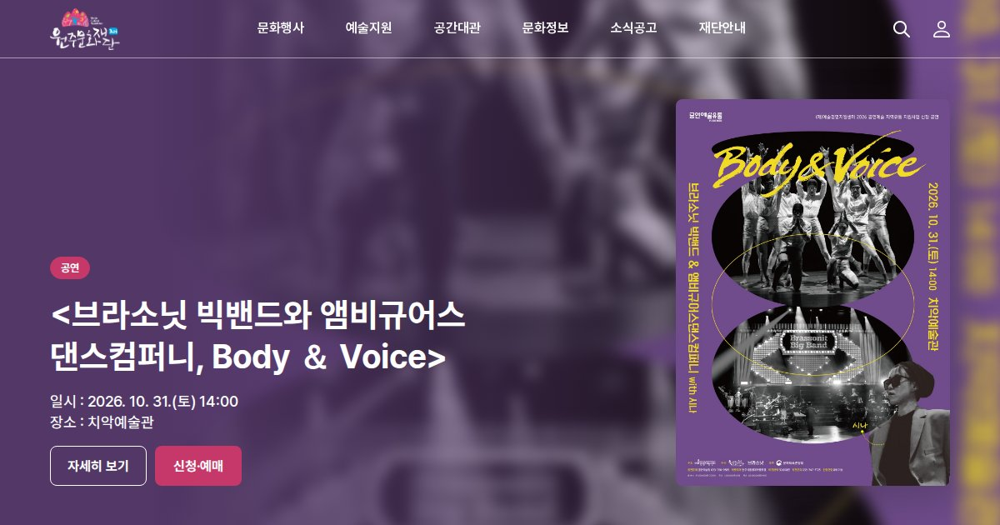

# 원주문화재단 메인 페이지 리디자인



원주문화재단 웹사이트 메인 페이지를 새로 디자인하고, HTML · CSS · JavaScript로 구현한 포트폴리오 작업입니다.<br>
화면 속 행사와 소식은 **2026년 10월 2일 기준**입니다.

## 주요 기능

- **메인 비주얼** : 7초마다 넘어가는 슬라이드, 정지/재생, 좌우로 밀어서 넘기기, 화면 밖에서는 자동 멈춤
- **헤더** : 하위 메뉴 드롭다운, 통합검색 창, 스크롤하면 흰 헤더로 전환
- **문화행사** : 분류 필터, 포스터 드래그 · 클릭 슬라이드
- **공간대관** : 탭을 누르면 배경 사진과 공간 정보가 바뀜
- **소식공고** : 분홍 바가 미끄러지는 탭
- **반응형** : PC · 태블릿 · 모바일 (모바일은 오른쪽에서 나오는 전체메뉴)
- **접근성** : 키보드 이동 표시, 글자 대비 4.5:1 이상, 움직임 줄이기 설정 대응

## 화면 구간

| 구간 | 폭 |
|---|---|
| PC | 1200px 이상 |
| 태블릿 | 768 ~ 1199px |
| 모바일 | 767px 이하 |

## 파일 구성

```
index.html   페이지 구조 (HTML)
style.css    디자인 (컬러 · 글꼴 변수, 반응형)
script.js    움직임 (슬라이드, 탭, 메뉴 등)
images/      이미지
```

## 디자인 시스템

- **컬러** : MAIN `#523767` · POINT `#DE4A7C` · TEXT `#26232B` · SUB TEXT `#6e6874` · BG `#F4F4F4`
- **글꼴** : Pretendard (섹션 제목 · 카드 제목 · 본문 · 분류명 · 설명 5단계)
